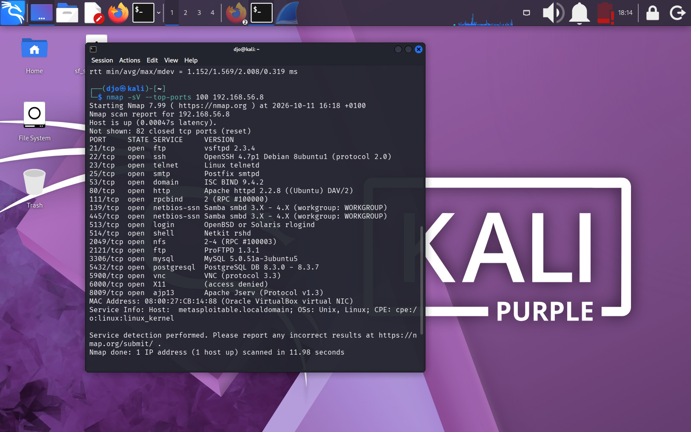
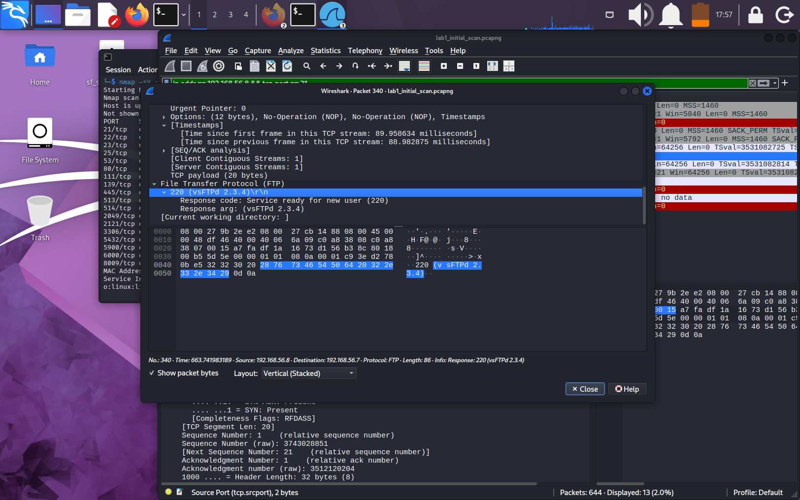

# Network Traffic Analysis Lab

A SOC L1 cybersecurity lab focused on network scanning and traffic analysis using Nmap and Wireshark.

## Project Overview

Using Nmap, I scanned the target host and identified open and closed ports.

I used Wireshark to analyze the captured network traffic, including TCP SYN and SYN-ACK packets.

I also examined the network services and their versions identified by Nmap.

## Objectives

- Understand network scanning with Nmap.
- Analyze captured network traffic using Wireshark.
- Identify TCP SYN and SYN-ACK packets.
- Understand how network services and open ports are identified.

## Lab Environment

- **Virtualization:** VirtualBox
- **Attacker Machine:** Kali Linux
- **Target Machine:** Metasploitable 2
- **Network Type:** Host-only
- **Kali Linux IP:** `192.168.56.7`
- **Target IP:** `192.168.56.8`
- **Network Subnet:** `192.168.56.0/24`

## Tools

- **Nmap:** Used to scan the target host and identify open ports and network services.
- **Wireshark:** Used to analyze captured network packets and investigate network traffic.

## Methodology

1. **Network Configuration:** Configured a Host-only network in VirtualBox to allow communication between the lab machines.
2. **Connectivity Test:** Used the `ping` command to verify connectivity between Kali Linux and Metasploitable 2.
3. **Nmap Scan:** Used Nmap to scan the target host and identify open and closed ports.
4. **Wireshark Analysis:** Analyzed the captured network traffic to examine TCP SYN and SYN-ACK packets.
5. **Results Correlation:** Compared the Nmap scan results with the captured packets to understand network responses.

## Results

### 1. Nmap Scan Results

The Nmap scan examined the 100 most common TCP ports and identified 18 open ports and 82 closed ports.

### 2. Service Identification

The Nmap scan identified multiple network services and their versions on the target host, including:

- **FTP:** vsFTPd 2.3.4 on port 21.
- **SSH:** OpenSSH 4.7p1 on port 22.
- **HTTP:** Apache 2.2.8 on port 80.
- **Samba:** SMB service on ports 139 and 445.
- **MySQL:** MySQL 5.0.51a on port 3306.
- **PostgreSQL:** PostgreSQL 8.3.x on port 5432.

### 3. Wireshark Analysis

I analyzed the captured network traffic using Wireshark. I examined TCP SYN and SYN-ACK packets to understand how the target host responded to connection requests.

I also examined the FTP traffic on port 21 and observed a server response identifying the service as vsFTPd 2.3.4.

### 4. Key Observations

- The target host had multiple open TCP ports.
- Nmap identified several network services and their versions.
- TCP SYN packets were used to initiate TCP connection requests.
- SYN-ACK responses indicated that some ports were accepting TCP connection attempts.
- The FTP server returned a banner identifying vsFTPd 2.3.4.
  
  

### 5. Security Findings

The scan revealed several network services running on the target host, including FTP, SSH, HTTP, Samba, MySQL, and PostgreSQL.

Identifying network services and their versions is an important step in a security assessment. However, service detection alone does not confirm that a vulnerability is present or exploitable.

## Skills Learned

- Network scanning with Nmap.
- Packet capture and traffic analysis with Wireshark.
- Understanding TCP SYN and SYN-ACK flags.
- Identifying network services and their versions.
- Comparing scan results with captured network traffic.
- Documenting technical findings in a cybersecurity investigation report.

## Conclusion

This lab provided practical experience in network scanning and traffic analysis within an isolated virtual environment. By combining Nmap and Wireshark, I learned how to identify network services, examine TCP connection attempts, and interpret responses from a target host.

